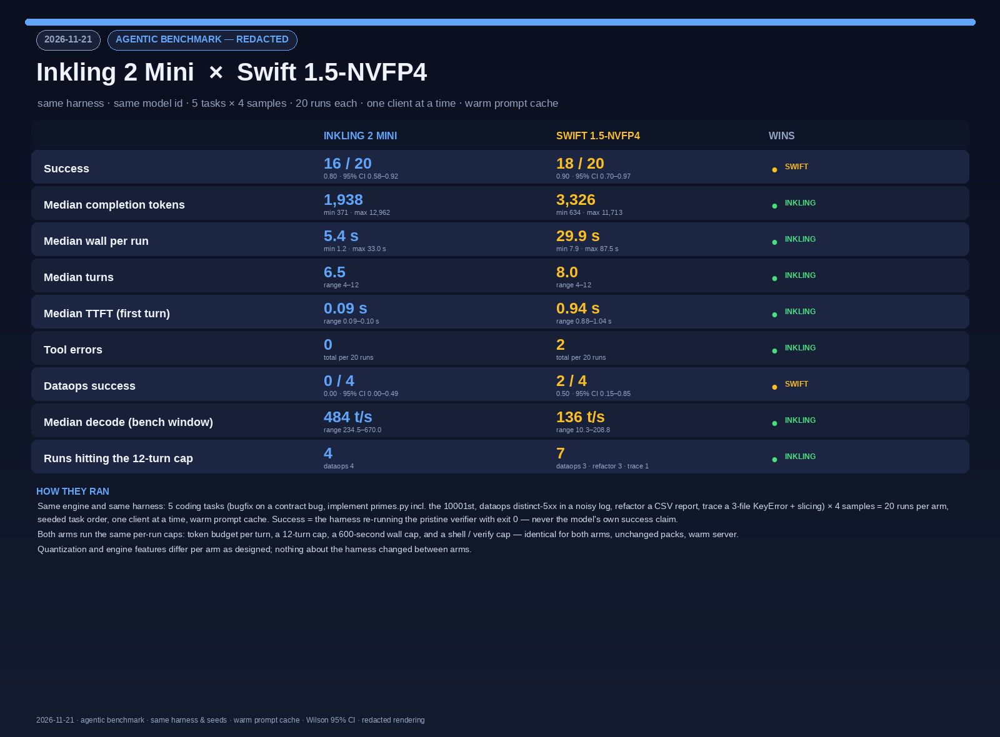

# mini-inkling-2-cow-test

An animated SVG story, paired with a redacted copy of a two-engine agentic benchmark comparison.

> **Redaction note.** Every benchmark figure here is public benchmark data (success rates, tokens, wall times, turns, first-token latency, decode speed, tool errors). All machine-specific details were stripped for this public copy: no device models, GPU/CPU names or memory footprints, no network ports or protocols, no internal artifact paths or directories, no seed or engine-config internals. Where any detail differs from the source, it is missing, not wrong.

---

## The story

**Greta** walks past the fence of her pasture, meets a lost calf in the next county, walks through the shallows with it, and comes home. Ten segments, each a self-contained inline SVG (viewBox 960×540, aspect-fit letterbox).

### Spec

- **Segments:** Title → The Notice → The Walk Out → The Meadow → The Wood → The Lost Calf → The Dog → The Crossing → The Return → Home
- **Animation:** walk cycle (leg swing + body bob) in two scenes, tail sway, standing bobbing, shivering calf, scrolling meadow background, grass sway, drifting clouds, twinkling stars, flapping bird, falling leaves, animated creek ripples, moon glow, breathing farmer, moonlit dusk.
- **Dialogue bubbles** are placed procedurally, never hand-placed. A canvas text measurement sets the box width; a priority-ordered candidate search then enforces three rules:
  1. The box stays inside the frame (margins from the viewBox edges),
  2. The box does not overlap any character on the scene (the speaker included),
  3. The box does not overlap any other bubble visible at the same time.
  The bubble's tail points at the speaker's position (nearest edge). If no candidate passes, the least-bad position is used and still never leaves the frame.
- **Transitions:** iris circle closes/opens with a glowing ring pulse and a white flash at the hand-off.
- **Controls:** auto-advance, pause/play, prev/next, restart, clickable segment dots, keyboard (← / → / space), progress bar, `#s=N` deep-link to a specific scene (pins the scene, animations keep running), `prefers-reduced-motion` support.

### How to view

Open `index.html` directly, or visit the published site (GitHub Pages). Append `#s=N` to the URL to start at segment `N` (1–10): `#s=1` is the Title, `#s=3` is the Walk Out.

---

## Benchmark comparison

**Same harness · same served model · 5 tasks × 4 samples = 20 runs per arm · one client at a time · warm prompt cache.**

Success = the harness re-running the pristine verifier with exit 0 — never the model's own success claim. 95% confidence intervals are Wilson intervals.

| Metric | Inkling 2 Mini | Swift 1.5-NVFP4 | Wins |
| --- | --- | --- | --- |
| Success | 16 / 20 (0.80 · CI 0.58–0.92) | 18 / 20 (0.90 · CI 0.70–0.97) | Swift |
| Median completion tokens | 1,938 (min 371 · max 12,962) | 3,326 (min 634 · max 11,713) | Inkling |
| Median wall per run | 5.4 s (min 1.2 · max 33.0 s) | 29.9 s (min 7.9 · max 87.5 s) | Inkling |
| Median turns | 6.5 (range 4–12) | 8.0 (range 4–12) | Inkling |
| Median TTFT (first turn) | 0.09 s (range 0.09–0.10 s) | 0.94 s (range 0.88–1.04 s) | Inkling |
| Tool errors | 0 (total per 20 runs) | 2 (total per 20 runs) | Inkling |
| Dataops success | 0 / 4 (CI 0.00–0.49) | 2 / 4 (CI 0.15–0.85) | Swift |
| Median decode (bench window) | 484 t/s (234.5–670.0) | 136 t/s (10.3–208.8) | Inkling |
| Runs hitting the 12-turn cap | 4 (dataops 4) | 7 (dataops 3 · refactor 3 · trace 1) | Inkling |

### Per-task

| Task | Inkling 2 Mini (success · med tokens · med wall · turns) | Swift 1.5-NVFP4 (success · med tokens · med wall · turns) |
| --- | --- | --- |
| bugfix | 4 / 4 · 564 · 1.5 s · 4.5 | 4 / 4 · 889 · 10.9 s · 4.5 |
| dataops | 0 / 4 · 4,897 · 15.5 s · 12.0 | 2 / 4 · 5,077 · 50.9 s · 12.0 |
| implement | 4 / 4 · 1,938 · 4.7 s · 4.0 | 4 / 4 · 2,026 · 18.1 s · 5.5 |
| refactor | 4 / 4 · 9,458 · 23.4 s · 8.5 | 4 / 4 · 10,720 · 83.8 s · 12.0 |
| trace | 4 / 4 · 1,902 · 5.2 s · 6.5 | 4 / 4 · 2,430 · 24.0 s · 9.0 |

### How they ran

Same engine and same harness: 5 coding tasks (a contract bug, implementing primes.py including the 10001st prime, distinct-5xx analysis in a noisy log, a CSV report refactor, a 3-file KeyError + slicing trace) × 4 samples = 20 runs per arm, seeded task order, one client at a time, warm prompt cache. Both arms run the same per-run caps (token budget per turn, a 12-turn cap, a 600-second wall cap, and a shell/verify cap) — identical for both arms, unchanged packs, warm server. Quantization and engine features differ per arm as designed; nothing about the harness changed between arms.

---

## Provenance

This repository was assembled from a single request: produce an animated SVG story whose dialogue balloons are placed procedurally, and publish a redacted copy of the associated benchmark comparison with its timings/statistics.

> The exact prompt (verbatim):
>
> *"Once completed place a redacted (anonimized) version of the html together with a markdown readme, containing the specs and the earlier session created PNG comparing swift and inkling models to a new github repo (with pages) called mini-inkling-2-cow-test, include this prompt and the timings/statistics, but strip any information regarding computer-specific paths or any other sensitive information."*

Story and benchmark were produced in the same working session, 2026-11-21.

## Files

- `index.html` — the animated story (self-contained, no dependencies).
- `assets/agentic-compare.png` — redacted benchmark card.
- `README.md` — this file.
